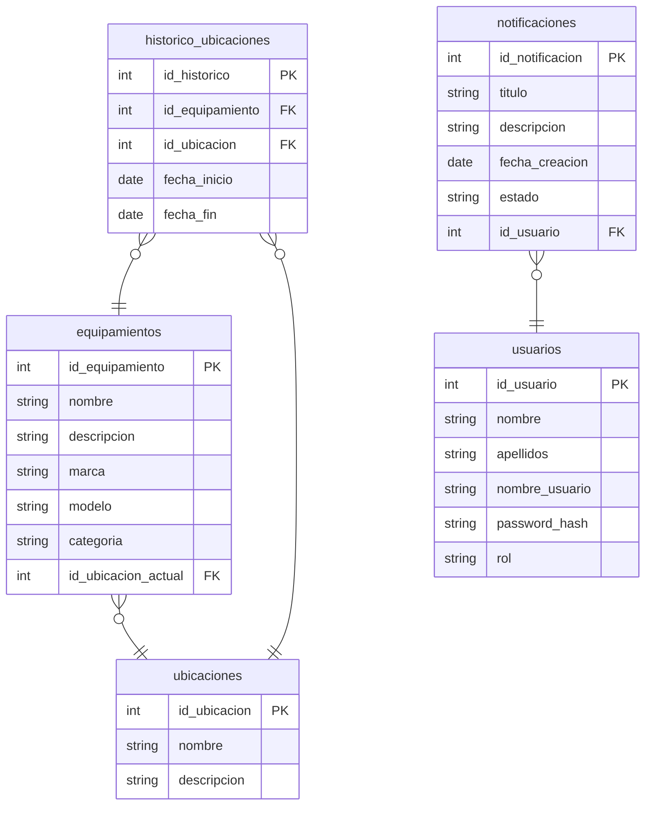
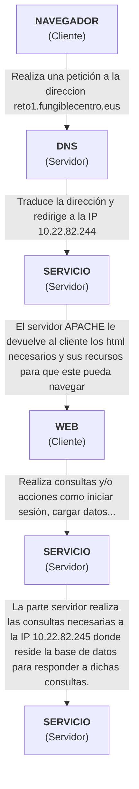

# GRUPO 2
* ## **Nombre:** LAJJ
* ## **Integrantes:**
    * *Alex* - UBICACIONES y HISTORICO_UBICACIONES (10.22.82.245)
    * *Javier* - USUARIO (10.22.82.246)
    * *Jonatan* - EQUIPAMIENTOS (10.22.82.243)
    * *Luis* - NOTIFICACION (10.22.82.244)

# Reto 1
* ## **Asignaturas:**
    * *Ciberseguridad*
    * *Desarollo de Interfaces Web*
    * *Desarollo WEB en Entorno Cliente*
    * *Desarollo WEB en Entorno Servidor*
    * *Despliegue de Aplicaciones WEB*
* ## **Estructura de carpetas:**
    * *RETO 1*
        * *App*
            * *api*
            * *controller*
            * *dao*
            * *model*
            * *view*
                * *assets*
                * *html*
                * *css*
                * *js*
        * *Public*

* ## **[Repositorio GitHub](https://github.com/MedievAlex/DAW_Reto_1_Alex_Javier_Luis_Jonatan.git)**

# Despliegue de la WEB

Para éste proyecto necesitamos dos máquinas virtuales, una con apache configurado, donde alojaremos nuestra aplicación web. Y otra máquina donde tendremos nuestra base de datos, en este caso con MariaDB. Tendrán que tener conexión entre las dos máquinas.

## Pasos para desplegar desde el git clone

Las dos máquinas son el servidor web (reto1.fungiblecentro.eus, 10.22.82.244) y el servidor de base de datos (MariaDB, 10.22.82.245). Los pasos se hacen en este orden:

1. En la máquina del servidor web, clonar el repositorio dentro de la carpeta que usa apache. Una vez clonado, para probar o actualizar la página solo hace falta hacer pull de la rama necesaria dentro de la carpeta del repositorio:

```bash
sudo mkdir -p /var/www/reto
cd /var/www/reto
git clone https://github.com/MedievAlex/DAW_Reto_1_Alex_Javier_Luis_Jonatan.git
```

2. Actualizar Ubuntu server:

```bash
sudo apt-get update
```

3. Instalar apache y activarlo:

```bash
sudo apt install apache2 -y
sudo systemctl enable --now apache2
```

4. Permitir apache en el firewall y habilitarlo, y abrir también los puertos que usa el proyecto (22/tcp, 3306/tcp, 53/udp y 53/tcp):

```bash
sudo ufw allow 'Apache Full'
sudo ufw allow 22/tcp
sudo ufw allow 3306/tcp
sudo ufw allow 53/udp
sudo ufw allow 53/tcp
sudo ufw enable
```

5. Instalar bind9:

```bash
sudo apt install bind9 bind9-utils dnsutils
```

6. Configurar la red de la máquina virtual: adaptador 1 en NAT y adaptador 2 en puente. En el netplan, el adaptador puente (enp0s8) lleva la IP 10.22.82.244/24, la ruta por defecto por 10.22.82.129 y los DNS 8.8.8.8 y 8.8.4.4.

7. Crear el archivo de configuración de apache y habilitarlo:

```bash
sudo nano /etc/apache2/sites-available/reto.conf
sudo a2ensite reto.conf
sudo a2dissite 000-default.conf
sudo systemctl reload apache2
```

El contenido de reto.conf está más abajo, en el apartado "En nuestro proyecto".

8. Configurar el DNS: añadir la zona reto1.fungiblecentro.eus en /etc/bind/named.conf.local y crear el archivo de zona /etc/bind/reto1.fungiblecentro.eus apuntando a 10.22.82.244. Los dos archivos están más abajo, en el apartado "En nuestro proyecto".

9. En la máquina de base de datos (10.22.82.245), tener MariaDB instalado y crear el usuario de DB ‘retoUser’, que es el único que utiliza la aplicación.

10. Comprobar con Dbeaver que la base de datos es la correcta y abrir reto1.fungiblecentro.eus en el navegador.

## Máquina con Apache:

Lo primero y más importante, actualizar Ubuntu server con el comando sudo apt-get update. De manera opcional se puede hacer después sudo apt-get upgrade. Una vez actualizado, tendremos que instalar apache con los siguientes comandos:

```bash
sudo apt install apache2 -y
sudo systemctl enable --now apache2
```

Para poder proceder sin problemas, permitiremos apache en el firewall y lo habilitaremos:

```bash
sudo ufw allow 'Apache Full'
sudo ufw enable
```

También instalaremos bind9 para dejar todo preparado en ésta máquina y no tener que estar cambiando la configuración de web todo el rato:

```bash
sudo apt install bind9 bind9-utils dnsutils
```

### Configuración VM:

Algo que vamos a necesitar es configurar la red de la máquina virtual. Necesitaremos hacerlo tanto en el propio sistema operativo, como en la aplicación de la VM. Lo que necesitaremos es lo siguiente:

Uno de los puertos ethernet en Bridge y otro en NAT (opcional).

```text
┌──────────────────────────────────────────────────────┐
│ Habilitar adaptador de red                           │
│ Conectar a:  [ NAT                               v ] │
└──────────────────────────────────────────────────────┘
```

```text
┌──────────────────────────────────────────────────────────────────┐
│ [ Adaptador 1 ] [ Adaptador 2 ] [ Adaptador 3 ] [ Adaptador 4 ]  │
├──────────────────────────────────────────────────────────────────┤
│ Habilitar adaptador de red                                       │
│ Conectar a:  [ Adaptador puente                              v ] │
└──────────────────────────────────────────────────────────────────┘
```

Dentro de nuestra máquina tendremos que acceder a la configuración del netplan. Dentro de este archivo, tendremos una estructura similar a ésta:

```yaml
network:
  version: 2
  renderer: networkd
  ethernets:
    enp0s3:
      dhcp4: true
      dhcp6: true
```

El enp0s3 hace referencia al adaptador 1 que está en NAT, y el enp0s8 hace referencia al adaptador puente. Para alojar nuestra web, debemos configurar un sitio web básico. Primero, crearemos una carpeta para la web:

```bash
sudo mkdir -p /var/www/mipagina
sudo chown -R $USER:$USER /var/www/mipagina
```

Dentro de ésta ruta, crearemos un index.html para ver si es funcional, sirve uno de prueba tan simple como esto:	

```bash
echo "<h1>Hola desde Apache</h1>" > /var/www/mipagina/index.html
```

El ‘>’ en este comando hace que inserte dentro de index.html lo que hay dentro de las comillas del echo y cree el archivo index.html.

Ahora, dentro de la configuración de apache, tenemos que crear nuestro propio archivo de configuración. Para ello, haremos lo siguiente:

```bash
sudo nano /etc/apache2/sites-available/mipagina.conf
```

Dentro de este archivo de configuración tendremos que decir donde se encuentra nuestra página y el nombre, con algo similar a ésto:

```apache
<VirtualHost *:80>
	ServerAdmin webmaster@mipagina.local
	ServerName mipagina.local
	DocumentRoot /var/www/mipagina
	ErrorLog ${APACHE_LOG_DIR}/mipagina_error.log
	CustomLog ${APACHE_LOG_DIR}/mipagina_access.log combined
</VirtualHost>
```

El siguiente paso es habilitar nuestra página, para ello introduciremos los siguientes comandos:

```bash
sudo a2ensite mipagina.conf
sudo systemctl reload apache2
```

Si por alguna razón carga la página por defecto, se puede introducir esto:

```bash
dissite 000-default.conf
sudo systemctl reload apache2
```

### DNS

Necesitaremos también configurar el servidor DNS con Bind9 que instalamos previamente. Para ello tendremos que introducir éste comando:

```bash
sudo nano /etc/bind/named.conf.local
```

Dentro veremos esto:

```text
zone "grupo01.test" {
	type master;
	file "/etc/bind/db.grupo01.test";
};
```

Tendremos que cambiar los valores de zone y de la ruta del archivo más adelante. Tendremos que crear el archivo que se menciona en la ruta que aparece en named.conf.local. En caso de que se halla cambiado el nombre del archivo en esa ruta, lo pondremos de esa manera:

```bash
nano /etc/bind/tu.nombre.archivo
```

Y ahí dentro tendrémos que escribir éstos parámetros:

```text
$TTL 3600
@	IN SOA ns.grupo01.test. admin.grupo01.test. (
	1;
	3600;
	600;
	86400;
	3600);
@	IN NS ns.grupo01.test.
Ns	IN A 192.168.1.50
@	IN A 192.168.1.50
```

### En nuestro proyecto

Para que sea más clara la explicación, adjuntaremos ejemplos de las configuraciones de nuestro proyecto.

Primero, el archivo de configuración de netplan lo configuramos de la siguiente manera: 

```yaml
network:
  ethernets:
    enp0s3:
      dhcp4: true
      dhcp6: true
    enp0s8:
      dhcp4: false
      dhcp6: false
      addresses:
        - 10.22.82.244/24
      routes:
        - to: default
          via: 10.22.82.129
      nameservers:
        addresses: [8.8.8.8, 8.8.4.4]
  version: 2
```

La ruta donde se alojará nuestra página es la siguiente: 

```text
root@retodaw:/var/www/reto/
```

Dentro de esta carpeta llamada “reto” tenemos la carpeta cual es la carpeta del repositorio en el cual hemos estado trabajando. Para así solo necesitar hacer pulls de la rama necesaria para realizar las pruebas o actualizar la página. Con lo cual, la ruta se quedaría así:

```text
root@retodaw:/var/www/reto/DAW_Reto_1_alex_JAvier_Luis_Jonatan
```

En el archivo de configuración de apache es el siguiente. El cual está configurado de la siguiente manera:

```bash
sudo nano /etc/apache2/sites-available/reto.conf
```

```apache
<VirtualHost *:80>
	ServerAdmin luisvazquez8942@gmail.com
	DocumentRoot /var/www/reto
	ServerName reto1.fungiblecentro.eus
	<Directory /var/www/reto>
		Options Indexes FollowSymLinks
		AllowOverride All
		Require all granted
		AddType application/x-httpd-php .php
	</Directory>
	ErrorLog ${APACHE_LOG_DIR}/error.log
	CustomLog ${APACHE_LOG_DIR}/access.log combined
	</VirtualHost>
```

Para el servicio DNS, el archivo de configuración de Bind tenemos lo siguiente:

```text
Zone “reto1.fungiblecentro.eus” {
	type master;
	file “/etc/bind/reto1.fungiblecentro.eus”;
};
```

Y el archivo de zona está así configurado:

```text
$TTL 3600
@	IN SOA ns.reto1.fungiblecentro.eus. admin.fungiblecentro.eus. (
	1;
	3600;
	600;
	86400;
	3600);
@	IN NS ns.reto1.fungiblecentro.eus.
Ns	IN A 10.22.82.244
@	IN A 10.22.82.244
```

Respecto a los permisos con ufw, los siguientes mostrados en la captura son los permisos dados para ciertas peticiones, y estos son los puertos y protocolos que permitimos:

```text
root@retodaw:/var/www/reto# ufw status
Status: active

To                         Action      From
--                         ------      ----
Apache Full                ALLOW       Anywhere
22/tcp                     ALLOW       Anywhere
3306/tcp                   ALLOW       10.22.84.122
3306/tcp                   ALLOW       Anywhere
3306/tcp                   ALLOW       10.22.84.87
53/udp                     ALLOW       Anywhere
53/tcp                     ALLOW       Anywhere
Apache Full (v6)           ALLOW       Anywhere (v6)
22/tcp (v6)                ALLOW       Anywhere (v6)
3306/tcp (v6)              ALLOW       Anywhere (v6)
53/udp (v6)                ALLOW       Anywhere (v6)
53/tcp (v6)                ALLOW       Anywhere (v6)
```

La razón de tener tantos ha sido debido a problemas con ciertas llamadas.

## Máquina con SQL:

Si bien es cierto que no hay mucha cosa configurada en ésta máquina, es indispensable para que funcione el reto correctamente. Lo principal y más importante además de tener instalado MariaDB, es la creación de un usuario de DB. Para empezar, estos son los usuarios que tenemos:

```text
MariaDB [(none)]> SELECT user FROM mysql.user;
+-------------+
| User        |
+-------------+
| luisI       |
| retoUser    |
| retosql     |
| retoapache  |
| retosql     |
| mariadb.sys |
| mysql       |
| root        |
+-------------+
8 rows in set (0,002 sec)

MariaDB [(none)]>
```

El único usuario que utilizamos es ‘retoUser’, el resto son usuarios que se pueden eliminar (salvo root ,mariadb.sys y mysql), porque eran todos usuarios de prueba.

Utilizando Dbeaver se puede comprobar en la siguiente imagen que el resultado de la base de datos es la correcta y coincide con el esquema realizado al inicio del proyecto.



## Esquema red:

Para finalizar, este es el esquema del resultado de nuestra red:

